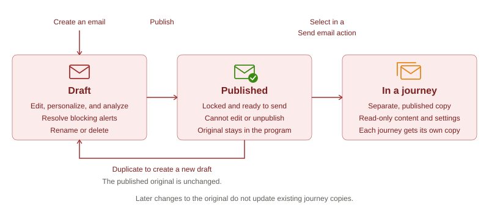
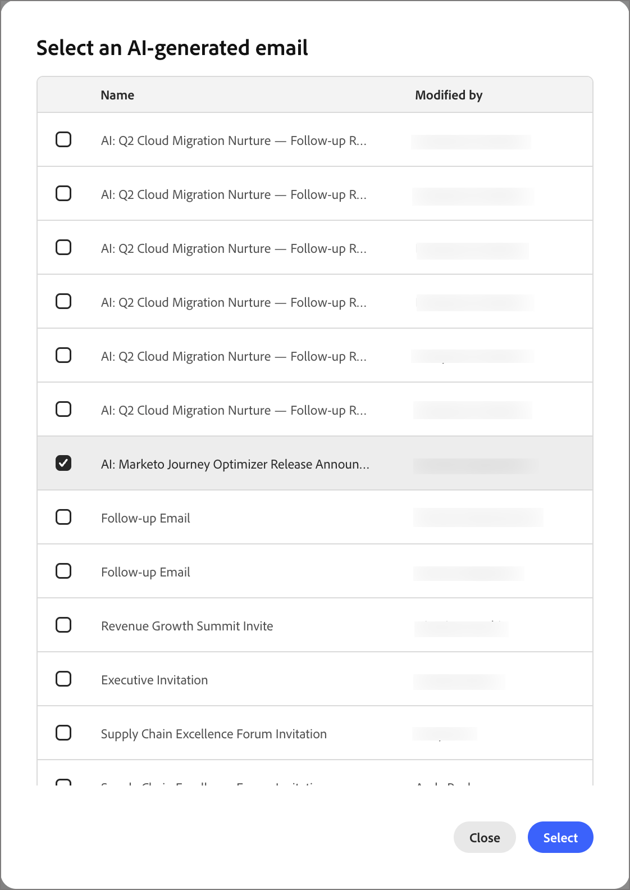

# 이메일 만들기 및 여정 추가

[!DNL Adobe Marketo Optimizer]은(는) B2B 마케터에게 최신 엔터프라이즈급 이메일 작성 및 게재 환경을 제공하므로 프로그램 및 여정에서 이메일을 만들고 게시하고 보낼 수 있습니다.

이메일은 독립 실행형 자산이므로 만들기 위해 여정이 필요하지 않습니다. [프로그램 또는 해당 폴더 내에서 전자 메일을 만들고](#create-email-from-programs), 준비가 되면 [게시](#publish-email)한 다음 [해당 프로그램의 모든 여정에서 전송](#add-email-from-journey)합니다.

## 이메일 라이프사이클 {#lifecycle}

이메일은 항상 다음 상태 중 하나입니다.

| 주 | 설명 |
| ----- | ----------- |
| **초안** | 모든 새 이메일은 초안으로 시작되며 이는 프로그램 트리에 빨간색 봉투 아이콘으로 표시됩니다. 속성, 작업 및 콘텐츠를 편집하고 개인화, 분석, 이름 변경 또는 삭제할 수 있습니다. |
| **게시됨** | 게시된 이메일은 잠겨 있으며 보낼 준비가 되어 있으며 녹색 봉투 아이콘으로 표시됩니다. 편집하거나 게시를 취소할 수 없으며 여정에서 이메일을 선택하면 나열됩니다. |
| **여정** | _전자 메일 보내기_ 작업에서 게시된 전자 메일을 선택하면 여정에 속하는 게시된 복사본이 만들어집니다. 사본은 읽기 전용이며 나중에 원본을 복제하고 수정하는 경우에는 변경되지 않습니다. |

게시하면 이메일이 초안에서 게시로 이동합니다. _전자 메일 보내기_ 작업 노드에 대해 선택된 경우 복사본이 여정에 있습니다. 게시된 전자 메일을 변경하려면 [복제](#duplicate-email)하세요. 복제본이 동일한 콘텐츠 및 설정을 갖는 초안으로 생성됩니다.

{width="800" zoomable="yes"}

이메일 상태에 따라 작업 가용성이 결정됩니다.

| 액션 | 초안 | 게시일 | 여정 |
| ------ | ----- | --------- | ------------ |
| 속성, 작업 및 컨텐츠 편집 | 예 | 아니요 | 아니요 |
| 이메일 개인화 | 예 | 아니요 | 아니요 |
| 이메일 분석 | 예 | 아니요 | 아니요 |
| 게시 | 예, 차단 경고가 해결되면 | 이미 게시됨 | 자동으로 게시됨 |
| 복제 | 예 | 예 | 아니요 |
| 이름 바꾸기 | 예 | 아니요 | 아니요. 복사본 이름을 선택하면 이름을 지정합니다. |
| 삭제 | 예 | 아니요 | 아니요. 대신 _전자 메일 보내기_ 노드를 삭제하십시오. |
| 여정에서 선택 | 아니요 | 예 | 적용할 수 없음 |

## 필요 조건 {#before-you-begin}

사용자 역할에 수행하는 작업에 대해 다음 [제품 권한](../start/permissions-reference.md)이 포함되어 있는지 확인하십시오.

* **[!UICONTROL B2B 프로그램 보기]** 및 **[!UICONTROL B2B 폴더 보기]** - 전자 메일이 있는 프로그램 및 폴더를 봅니다.
* **[!UICONTROL B2B 전자 메일 보기]** - 전자 메일 메시지를 봅니다.
* **[!UICONTROL B2B 전자 메일 관리]** - 전자 메일 만들기, 편집, 복제, 이름 변경, 삭제 및 게시
* **[!UICONTROL B2B 개인 여정 관리]** - 개인 여정에서 전자 메일 동작을 추가하거나 바꿉니다. 여정에 대한 읽기 전용 액세스는 **[!UICONTROL B2B 개인 여정 보기]**&#x200B;를 사용하십시오.
* **[!UICONTROL B2B 대화 환경 관리]** - [!DNL Coworker]에 액세스하여 전자 메일을 개인화하거나 분석할 수 있습니다. [!DNL Coworker]의 작업에는 해당 전자 메일 권한도 필요합니다.

다음과 같은 관련 설정 또는 전송 작업을 수행하는 경우에만 추가 권한이 필요합니다.

* **[!UICONTROL B2B 프로그램 관리]** - 프로그램이 없는 경우 프로그램을 만듭니다.
* **[!UICONTROL B2B 채널 구성 관리]** 및 **[!UICONTROL B2B 전자 메일 설정 보기]** - 전자 메일 채널 구성을 만듭니다. 또한 관리자는 전자 메일 게재 설정을 구성하려면 **[!UICONTROL B2B 전자 메일 설정 관리]**&#x200B;가 필요합니다.
* **[!UICONTROL B2B 개인 여정 게시]** - 전자 메일을 보내는 여정을 게시합니다.

이메일을 만들기 전에 다음을 확인하십시오.

* 이메일은 프로그램 또는 해당 폴더 중 하나에 있습니다. 이메일을 만들기 전에 프로그램을 정의합니다. 여정은 자체 프로그램에서만 이메일을 보낼 수 있습니다.
* 전자 메일 채널 구성을 선택하려면 전자 메일 **[!UICONTROL 작업]** 탭을 사용하십시오. 관리자는 [전자 메일 채널 구성](../admin/email-channel-configuration.md)을 관리합니다.
* 프로그램 내에서 필요한 만큼 이메일을 만들 수 있습니다.

>[!NOTE]
>
>전자 메일을 처음 보내는 경우 [전자 메일 게재 기능](../start/email-deliverability.md) 및 필요한 [전자 메일 채널](../admin/email-channel-configuration.md)이 구성되어 있는지 확인하십시오.

<!-- 
* **Email channel configurations** - Manage the sender identity, reply behavior, marketing vs. transactional message types, and tracking.
* **Email deliverability controls** - Set up your email deliverability channel, including subdomain delegation (Fully Delegated and CNAME methods), DMARC, SPF/DKIM auto-configuration, and shared IP pool support.
* **Send Email action** - From a journey, add a _Send email_ action node, including personalization using profile attributes (Handlebars syntax).
* **Visual drag-and-drop email design tools** -  Design your email content with structures, content components, themes, dark-mode support, and reusable visual fragments.
* **Marketo Design Studio assets** — Choose images and assets from a one-time copy of your Marketo Engage asset library directly inside the email canvas.
* **Reusable templates and fragments** — Save common headers, footers, CTAs, and full email layouts and reuse them across journeys.
* **Role-Based Access Control (RBAC)** — Apply granular permissions for creating, editing, approving, and sending email. 
-->

>[!BEGINSHADEBOX]

## 현재 제한 사항 {#limitations}

* **테스트 프로필, 콘텐츠 시뮬레이션 및 증명 보내기**&#x200B;는 현재 릴리스에서 사용할 수 없습니다. Litmus 렌더링 및 SpamAssassin 기반 스팸 보고서는 향후 릴리스할 예정입니다.
* **계정 수준 개인화 및 사용자 지정 개체 데이터**&#x200B;는 현재 릴리스에서 사용할 수 없습니다. 프로필 속성을 사용합니다.
* 기존 [!DNL Marketo Engage] 템플릿의 **Velocity-to-Handlebars 자동 마이그레이션**&#x200B;을(를) 요청 시 사용할 수 있습니다.
* **전자 메일 댓글 및 공동 작업**(인라인 댓글, @mentions, 요청 검토 워크플로)이 향후 릴리스에 예정되어 있습니다.
* **AEM Assets, AEM 콘텐츠 조각 및 Adobe Express** 통합이 향후 릴리스에 예정되어 있습니다.

>[!ENDSHADEBOX]

## 주요 개념 {#key-concepts}

개인 여정을 위한 이메일을 만들고 이메일 콘텐츠를 작성하기 전에 다음 개념을 검토하십시오.

| 개념 | [!DNL Adobe Marketo Optimizer]에서 |
| ------- | ---------------------- |
| **_[전자 메일 디자인 공간](../content/email-authoring.md#email-design-tools)_** | 이메일 콘텐츠를 구성하는 데 사용되는 시각적 캔버스 및 디자인 도구입니다. 여기에는 드래그 앤 드롭 레이아웃 구성 요소, 템플릿, 조각, 테마 및 개인화 편집기가 포함되어 있습니다. |
| **_[템플릿](../content/templates.md)_** | 새 이메일을 만드는 데 사용할 수 있는 재사용 가능한 이메일 레이아웃. Adobe에서 제공하는 내장 샘플 템플릿 또는 팀에서 만드는 사용자 지정 빌드 템플릿일 수 있습니다. |
| **_[시각적 조각](../content/fragments.md)_** | 여러 이메일에 삽입할 수 있는 재사용 가능한 콘텐츠 블록(예: 머리글, 바닥글, CTA, 법적 고지 사항). 조각을 업데이트하면 해당 조각을 사용하는 모든 이메일에 변경 사항이 전파됩니다. |
| **_[테마](../content/email-authoring.md#design-from-scratch)_** | 이메일 전체에 적용되는 재사용 가능한 스타일 사전 설정(색상, 타이포그래피, 간격, 버튼 스타일). |
| **_[Personalization 토큰](../content/personalization-expressions.md)_** | Handlebars 식(예: `{{profile.firstName}}`)은 각 받는 사람의 프로필 데이터를 사용하여 전송 시 확인됩니다. |
| **_[독립 실행형 전자 메일](#lifecycle)_** | 모든 여정과 독립적으로 존재하는 이메일 에셋입니다. 프로그램 또는 해당 폴더 중 하나에서 만들어지고 초안에서 게시로 이동합니다. |
| **_[전자 메일 형식](#email-types)_** | 전자 메일을 만들 때 선택하는 분류입니다. **[!UICONTROL 마케팅]** 또는 **[!UICONTROL 트랜잭션]**. 동의 목적을 위해 메시지를 처리하는 방법을 [!DNL Marketo Optimizer]에 알려줍니다. |
| **_[전자 메일 동작 보내기](./action-nodes.md#add-an-action-node)_** | 채널 구성 및 이메일 콘텐츠를 사용하여 이메일을 전달하는 여정 작업 노드입니다. |

## 이메일 유형 {#email-types}

이메일을 만들 때 유형을 선택합니다. 유형은 동의 목적으로 메시지를 처리하는 방법을 [!DNL Marketo Optimizer]에 알려주므로 메시지를 보내는 이유와 일치하는 유형을 선택하십시오.

| 유형 | 다음에 사용 |
| ---- | ------- |
| **[!UICONTROL 마케팅]** | 제품 출시 발표, 뉴스레터 또는 이벤트 초대와 같은 프로모션 메시지. |
| **[!UICONTROL 트랜잭션]** | 주문, 등록 또는 배송 확인과 같은 작업을 수행했기 때문에 개인이 예상하는 운영 메시지. |

유형이 **[!UICONTROL 속성]** 탭에 전자 메일 **[!UICONTROL 범주]**(으)로 나타납니다.

## 프로그램 트리에서 전자 메일 만들기 {#create-email-from-programs}

프로그램 또는 폴더에 이메일을 만들어 여정과 독립적으로 빌드합니다.

1. 왼쪽 탐색에서 **[!UICONTROL 마케팅 관리]**&#x200B;를 확장하고 **[!UICONTROL 프로그램]**&#x200B;을 선택합니다.

1. 프로그램 트리에서 _자세히_ 아이콘(**...**)을 클릭합니다. 전자 메일을 만들려는 프로그램 또는 폴더 옆에 **[!UICONTROL 전자 메일 만들기]**&#x200B;를 선택합니다.

   {width="400"}

1. _[!UICONTROL 전자 메일 만들기]_ 대화 상자에서 다음 필드를 작성합니다.

   * **[!UICONTROL 상위]** - (필수) 전자 메일이 저장된 프로그램 또는 폴더입니다. 시작한 프로그램으로 설정되어 있으며 다른 프로그램 또는 프로그램의 폴더 중 하나로 변경할 수 있습니다.

   * **[!UICONTROL 이메일 유형]** - **[!UICONTROL 마케팅]** 또는 **[!UICONTROL 트랜잭션]**&#x200B;을(를) 선택합니다([이메일 유형](#email-types) 참조).

   * **[!UICONTROL 이름]** - (필수) 프로그램 트리에 전자 메일을 식별하는 이름을 입력합니다.

   * **[!UICONTROL 설명]** - (선택 사항) 팀에 전자 메일 및 해당 목적에 대한 메모를 입력합니다.

   {width="400"}

1. **[!UICONTROL 만들기]**&#x200B;를 클릭합니다.

이메일은 자체 탭에서 열리고 프로그램 트리의 프로그램 아래에 초안으로 표시됩니다. 전자 메일이 열려 있는 동안에는 해당 전자 메일에 대한 [!DNL Coworker] 프롬프트의 범위가 지정됩니다.

다음으로 [전자 메일을 설정](#define-email-properties), [모든 경고를 해결](#alerts) 및 [게시](#publish-email)합니다.

### 이메일 속성 및 작업 정의 {#define-email-properties}

초안 이메일에는 **[!UICONTROL 속성]**, **[!UICONTROL 작업]** 및 **[!UICONTROL 콘텐츠]**&#x200B;의 세 가지 탭이 있습니다. 순서대로 작업한 다음 변경 사항을 저장합니다. 전자 메일 페이지는 프로그램 트리에서 전자 메일을 만들 때 열립니다. 나중에 초안을 열려면 프로그램 트리에서 이메일을 선택하십시오.

#### 속성 및 작업 탭을 완료합니다 {#properties-actions-tabs}

1. (선택 사항) **[!UICONTROL 속성]** 탭에서 **[!UICONTROL 설명]** 및 전자 메일에 대해 캡처할 기타 설명 정보를 입력합니다.

   {width="800" zoomable="yes"}

1. **[!UICONTROL 작업]** 탭을 선택하고 전자 메일에 대한 기능 설정을 완료합니다.

   * **[!UICONTROL 전자 메일]** - 사용할 **[!UICONTROL 전자 메일 채널 구성]**&#x200B;을 선택하거나 만듭니다.

     발신자 ID, 회신 주소, 하위 도메인, IP 풀, 이메일 유형(마케팅 또는 트랜잭션) 및 추적을 정의하는 재사용 가능한 이메일 게재 설정 세트입니다. _보기_ 아이콘을 클릭하여 선택한 구성에 대한 설정을 검토합니다.

     관리자는 [전자 메일 채널 구성](../admin/email-channel-configuration.md)에서 구성을 만듭니다.

   * **[!UICONTROL 비즈니스 규칙]** - (선택 사항) 규칙 집합을 선택하여 전자 메일 작업에 최대 가용량 또는 자동 시간 규칙을 적용합니다.

     비즈니스 규칙과 채널 통신을 위한 규칙 집합을 정의하고 활성화하는 방법에 대한 자세한 내용은 [_비즈니스 규칙_](../admin/business-rules.md)&#x200B;을 참조하세요.

   * **[!UICONTROL 작업 추적]** - 전자 메일에 대해 추적할 작업의 확인란을 선택합니다.

   {width="600" zoomable="yes"}

#### 제목란 및 콘텐츠 추가 {#content-tab}

1. **[!UICONTROL 콘텐츠 편집]**&#x200B;을 클릭하거나 **[!UICONTROL 콘텐츠]** 탭을 선택하십시오.

   {width="500" zoomable="yes"}

1. 전자 메일의 제목 필드에 표시할 **[!UICONTROL 제목 줄]** 텍스트를 입력하십시오.

   제목 줄은 필수입니다.

   필드에서 개인화 토큰을 사용하려면 _개인화_ 아이콘( )을 클릭하십시오.

1. (선택 사항) 게시 프로세스 중에 이메일 HTML의 크기를 줄이려면 **[!UICONTROL HTML 크기 최적화]** 확인란을 선택합니다.

   이렇게 하면 Gmail과 같은 클라이언트에서 이메일 클리핑을 방지할 수 있습니다. Gmail은 100KB를 초과하는 메시지를 자릅니다. 자세한 내용은 [_이메일 HTML 크기 최적화_](#optimize-html-size)&#x200B;를 참조하십시오.

1. **[!UICONTROL 전자 메일 본문 편집]**&#x200B;을 클릭하여 시각적 디자인 도구에 액세스하고 [콘텐츠 빌드](../content/email-authoring.md)를 시작합니다.

   또는 **[!UICONTROL 코드 편집기]**&#x200B;를 클릭하여 일반 HTML에서 자신의 콘텐츠를 코딩할 수 있습니다. 이메일 디자인에 재사용할 기존 HTML이 있는 경우 이를 복사하여 편집기에 붙여넣을 수 있습니다.

### 경고 확인 {#alerts}

전자 메일 헤더의 **[!UICONTROL 경고]** 단추는 [!DNL Adobe Marketo Optimizer]에서 발견된 문제의 수를 보여줍니다. 목록을 표시하려면 클릭합니다.

{width="450"}

경고는 두 종류로 제공됩니다.

* **차단 문제** - 이러한 문제가 남아 있는 동안에는 **[!UICONTROL 게시]**&#x200B;를 사용할 수 없으며, 전자 메일의 _자세히_ 메뉴에 **[!UICONTROL 게시로 전자 메일 경고 해결]**&#x200B;이 표시됩니다. 이메일을 게시하기 전에 모든 차단 문제를 해결하십시오.

  해당 예는 다음과 같습니다.

  * 보낸 사람 이름이 비어 있음
  * 제목 줄이 누락되었습니다.
  * 이메일 콘텐츠가 비어 있음

* **경고** - 검토할 가치가 있는 사항을 지적하지만 게시를 금지하지는 않습니다. 이메일은 경고를 표시할 수 있으며 나머지 경고가 경고인 경우 게시됩니다.

  해당 예는 다음과 같습니다.

  * 옵트아웃 링크가 이메일 본문에 없습니다.
  * HTML의 텍스트 버전이 비어 있음
  * 빈 링크가 검색됨
  * 이메일이 100K를 초과함

## 프로그램 트리에서 이메일 관리 {#manage-emails}

이메일은 봉투 아이콘과 함께 프로그램 트리에 나타납니다. 빨간색 봉투는 초안을 표시합니다. 녹색 봉투는 게시된 이메일을 표시합니다. _자세히_ 아이콘(**...**)을 클릭합니다. 이메일 옆에 있어 관리합니다.

{width="400"}

초안 전자 메일의 메뉴에는 **[!UICONTROL 게시]**, **[!UICONTROL 전자 메일 개인화]**, **[!UICONTROL 전자 메일 분석]**, **[!UICONTROL 복제]**, **[!UICONTROL 이름 바꾸기]** 및 **[!UICONTROL 삭제]**&#x200B;가 있습니다.

게시된 전자 메일의 경우 **[!UICONTROL 복제]**&#x200B;만 선택할 수 있습니다.

### 이메일 개인화 및 분석 {#personalize-analyze}

전자 메일이 초안일 때 _자세히_ 메뉴에 두 개의 콘텐츠 도구가 포함되어 있습니다. 게시된 이메일은 변경할 수 없으므로 게시하기 전에 이를 실행하십시오.

* **[!UICONTROL 전자 메일 개인화]** - 전자 메일이 로드된 상태로 [!DNL Coworker]을(를) 엽니다. 이메일에 개인화된 콘텐츠를 추가하려면 대상 그룹을 설명하십시오. 자세한 내용은 [_사용자별 전자 메일 콘텐츠 개인화_](../agents/personalize-content.md)&#x200B;를 참조하십시오.

  {width="700" zoomable="yes"}

* **[!UICONTROL 전자 메일 분석]** - 이미 만든 콘텐츠를 검토합니다. [기존 전자 메일 분석](../agents/personalize-content.md#analyze-existing-email)을 참조하세요.

### 이메일 게시 {#publish-email}

이메일을 보낼 준비가 되면 게시합니다. [여정에서 전자 메일을 선택](#add-email-from-journey)하면 게시된 전자 메일만 나열됩니다.

1. 이메일에 차단 [경고](#alerts)가 없는지 확인하세요.

1. 프로그램 트리에서 _자세히_ 아이콘(**...**)을 클릭합니다. 전자 메일 옆에 있는 **[!UICONTROL 게시]**&#x200B;를 선택합니다.

1. _[!UICONTROL 전자 메일 게시]_ 확인 대화 상자에서 **[!UICONTROL 게시]**&#x200B;를 클릭합니다.

   {width="400"}

이메일 아이콘이 녹색으로 바뀝니다. 이메일을 선택하면 컨텐츠, 속성 및 작업을 요약하는 읽기 전용 보기로 열립니다.

{width="700" zoomable="yes"}

>[!IMPORTANT]
>
>게시는 영구적입니다. 게시된 이메일은 편집, 이름 변경, 삭제 또는 초안으로 반환할 수 없습니다. 변경하려면 [전자 메일을 복제](#duplicate-email)하세요.

### 이메일 복제 {#duplicate-email}

게시된 이메일을 변경하려면 복제하십시오. 원본을 변경하지 않고 변형을 시도하려면 초안을 복제할 수도 있습니다.

1. 프로그램 트리에서 _자세히_ 아이콘(**...**)을 클릭합니다. 전자 메일 옆에 있는 **[!UICONTROL 복제]**&#x200B;를 선택합니다.

1. 필요한 경우 _[!UICONTROL 전자 메일 복제]_ 대화 상자에서 **[!UICONTROL 이름]**&#x200B;을 변경합니다.

   기본적으로 원래 이름 다음에 `_copy`이(가) 옵니다. 필요한 경우 **[!UICONTROL 설명]**&#x200B;을(를) 추가합니다.

   {width="400"}

1. **[!UICONTROL 복제]**&#x200B;를 클릭합니다.

복제본이 동일한 콘텐츠 및 설정을 갖는 초안으로 생성됩니다. 변경한 다음 게시합니다.

## 여정에 이메일 추가 {#add-email-from-journey}

이메일을 보내려면 동일한 프로그램의 여정에 추가합니다. 전자 메일을 선택하면 [!DNL Marketo Optimizer]이(가) 해당 여정에 대한 전자 메일의 복사본을 만들고 자동으로 게시합니다. 전자 메일은 프로그램 트리에서 가져오므로 먼저 [전자 메일을 만들고 게시](#create-email-from-programs)하십시오.

두 개 이상의 여정에서 동일한 이메일을 사용할 수 있습니다. 선택할 때마다 해당 여정에 대해 별도의 사본이 만들어지고 각 사본에 고유한 이름을 지정할 수 있습니다.

### 이메일 보내기 작업을 위한 이메일 선택 {#select-email-in-journey}

1. 여정을 열고 [_작업 수행_ 노드를 선택하거나 추가하십시오](action-nodes.md#add-an-action-node).

1. _[!UICONTROL 작업 선택]_&#x200B;에서 **[!UICONTROL 전자 메일 보내기]**&#x200B;를 선택합니다.

1. _[!UICONTROL 전자 메일 원본]_&#x200B;에서 다음 중 하나를 선택하십시오.

   * **[!UICONTROL 프로그램 트리에서 전자 메일을 선택하십시오]** - 여정 프로그램 또는 해당 폴더에서 게시된 전자 메일을 사용하려면 이 옵션을 선택하십시오.

   * **[!UICONTROL AI 개인화 이메일 사용]** - AI 생성 이메일을 사용하려면 이 옵션을 선택하십시오. 이러한 이메일은 AI 지원 받은 편지함 클라이언트가 오퍼 및 작업 호출에서 요약 및 답변을 작성하도록 최적화되었습니다.

   {width="600"}

   이메일을 선택할 때까지 노드에 빈 이메일 이름이 표시됩니다.

1. **[!UICONTROL 전자 메일 선택]**&#x200B;을 클릭합니다.

   * **_프로그램 트리 전자 메일:_** _[!UICONTROL 전자 메일 선택]_ 대화 상자에서 전자 메일을 찾아 선택합니다.

     필요한 경우 **[!UICONTROL 전자 메일 검색]**&#x200B;을 사용하여 필터링하세요. 목록에서 이메일을 선택하여 미리 보고 제목 줄을 확인합니다.

     {width="600" zoomable="yes"}

     >[!NOTE]
     >
     >대화 상자에는 여정 프로그램 및 해당 폴더에서 게시된 이메일만 나열됩니다. 초안은 [게시](#publish-email)할 때까지 나타나지 않습니다. 이메일이 표시되지 않으면 게시된(녹색 아이콘)가 있고 올바른 프로그램에 있는지 확인합니다.

     **[!UICONTROL 이름]**&#x200B;에 여정 내에 전자 메일이 있어야 하는 이름을 입력하십시오.

     기본적으로 원래 이름 다음에 `_copy`이(가) 옵니다. 여정 컨텍스트에서 의미가 있는 이름으로 변경합니다.

   * **_AI 개인화 이메일:_** _[!UICONTROL AI 생성 이메일 선택]_ 대화 상자에서 개인화 이메일을 찾아 선택합니다.

     목록에서 개인화된 이메일을 선택합니다. 대화 상자에는 AI 라이브러리에 저장된 _AI 개인화 이메일_&#x200B;이 나열됩니다. 자세한 내용은 담당자별 이메일 콘텐츠 개인화 를 참조하십시오.

     {width="450" zoomable="yes"}

1. **[!UICONTROL 선택]**&#x200B;을 클릭합니다.

### 여정 이메일 사본 {#journey-copy}

복사본이 여정에 추가되고 게시되며 주황색 아이콘으로 프로그램 트리의 여정 아래에 나열됩니다. 고유한 작업 ID가 있으며 읽기 전용입니다.

{width="700" zoomable="yes"}

여정은 자체 복사본을 유지합니다. 이메일이 선택되는 즉시 콘텐츠와 구성이 복사됩니다. 나중에 원본을 복제하고 수정하는 경우 기존 여정이 복사한 버전을 계속 보냅니다.

선택적 [전송 시간 최적화](email-send-time-optimization.md)의 경우 이메일을 선택한 후 여정 작업 노드를 구성하십시오.

### 여정에서 이메일 업데이트 {#update-email-in-journey}

여정 복사본은 읽기 전용이므로 편집하지 않고 바꿉니다.

1. [게시된 원본 전자 메일을 복제](#duplicate-email)하고 초안을 변경한 다음 [게시](#publish-email)합니다.

1. 여정에서 _전자 메일 보내기_ 노드를 선택하고 _작업 수행_ 패널의 휴지통 아이콘을 사용하여 삭제합니다.

1. 새 _전자 메일 보내기_ 작업을 제자리에 추가하고 업데이트된 전자 메일을 선택합니다.

## 이메일 HTML 크기 최적화 {#optimize-html-size}

>[!CONTEXTUALHELP]
>id="ajo-b2b-prime_email_minification"
>title="HTML 크기 축소"
>abstract="이 옵션을 활성화하면 게시 시 불필요한 공백, 들여쓰기 및 불필요한 주석을 제거하여 이메일 HTML을 압축할 수 있습니다. 이렇게 하면 Gmail과 같은 클라이언트에서 이메일 클리핑을 방지할 수 있습니다. Gmail은 100KB를 초과하는 메시지를 자릅니다."

[!DNL Marketo Optimizer]을(를) 사용하면 불필요한 공백, 들여쓰기 및 불필요한 설명을 제거하여 게시 프로세스 중에 전자 메일 HTML 버전을 압축할 수 있습니다. HTML 크기를 작게 유지하면 다음과 같은 이점이 있습니다.

* **전자 메일 클리핑** 방지 - Gmail과 같은 일부 클라이언트는 ~100KB보다 큰 메시지를 잘라내어 수신자가 전체 콘텐츠를 볼 수 없습니다.
* 받는 사람의 받은 편지함에서 **전자 메일 로드 시간**&#x200B;을 개선합니다.
* **전달성**&#x200B;을 개선하고 대역폭 사용을 줄입니다.

이 최적화는 자동으로 적용되지 않습니다. _[!UICONTROL 콘텐츠]_ 탭에서 활성화해야 합니다.

<!--  -->

>[!IMPORTANT]
>
> HTML 크기 감소는 게시 시간에만 적용됩니다.

최적화는 이메일 클라이언트 안전 장치입니다.

* MSO/Outlook 조건부 주석을 보존합니다.
* 실제 콘텐츠, 이미지 또는 비디오는 변경되지 않습니다.

>[!NOTE]
>
>이메일 크기의 감소는 이메일의 원래 HTML 구조에 따라 다릅니다. 콘텐츠가 이미 컴팩트하거나 이메일 페이로드가 매우 큰 경우, 감소는 최소화될 수 있으며 클리핑을 완전히 방지할 수 없습니다.

<!-- 
Proof and simulate workflows are not available in this release. See [Current limitations](#limitations).

### Test HTML size optimization {#optimize-html-proof}

If you have enabled the [HTML size optimization](#optimize-html-size) option, you can evaluate its impact before publishing when sending proofs. Follow the following steps.

1. In the email design space, click the _Issues_ icon on the top right. If the rendered email size exceeds 100 KB, a message is displayed to warn you that this may cause truncation in some email clients.

1. Click **[!UICONTROL Simulate content]**.

1. To test the optimized version, click the **[!UICONTROL Send proof]** button and select the **[!UICONTROL Optimize HTML size]** option. This will send a proof with the reduced HTML size to your test recipients.

    >[!NOTE]
    >
    >This setting is independent from the email editor — the proof reflects what you select in the proof, regardless of whether the option is enabled or disabled in the email itself.

1. Select the test recipients and click **[!UICONTROL Send proof]**.

1. Back in the **[!UICONTROL Simulate]** screen, click the **[!UICONTROL View Proof]** button.

1. Click the _Information_ icon next to the status of the proof.

   The optimization details are displayed in a pop-up window, including the original HTML size, the optimized HTML size, and the size reduction percentage.
    
    Use this information to validate the optimized output and confirm the email stays within the recommended 100 KB threshold before publishing.

-->
