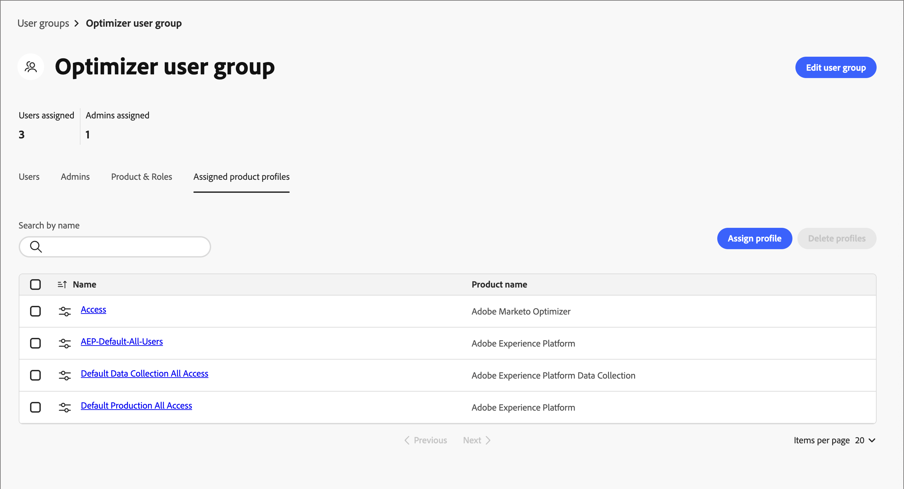
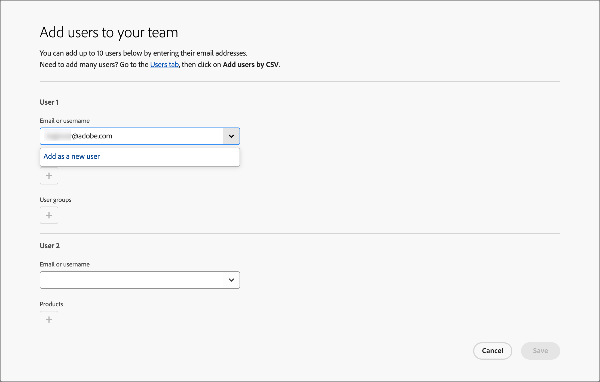
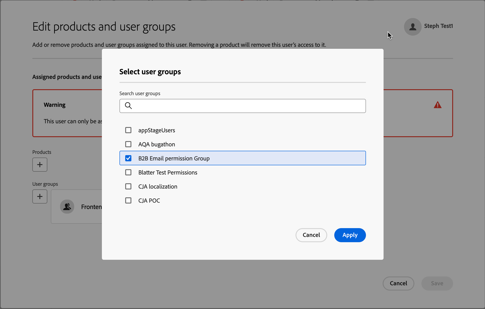
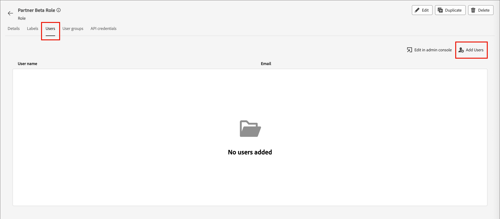

# 사용자 액세스 및 권한

프로비저닝이 완료되고 샌드박스가 바인딩되면 다음 단계를 완료하여 팀 및 사용자에게 [!DNL Marketo Optimizer] 액세스 권한을 제공하십시오.

1. Admin Console에서 [제품 프로필 만들기 [!DNL Marketo Optimizer] 제품 프로필 만들기](#create-profile)(1회/초기 설정만 해당).
1. Admin Console에서 [사용자 그룹 추가](#add-user-group).
1. Admin Console의 사용자 그룹에 [제품 프로필을 할당](#assign-profile)합니다.
1. Admin Console에서 [사용자를 새 그룹에 추가](#add-users)합니다.
1. [기본 제공 역할을 편집](#edit-role-permissions) 또는 [사용자 지정 역할을 만들기](#create-a-custom-role) 제품 권한과 Experience Platform에서 필요한 [!DNL Marketo Optimizer] 샌드박스를 사용합니다.
1. Adobe Experience Platform의 역할에 [사용자 추가](#add-users-to-a-role) 또는 [그룹](#add-user-groups-to-a-role).

관리자, 모든 액세스 사용자 및 읽기 전용 사용자에 대한 권장 사용자 그룹 및 역할을 설정하려면 [제안된 사용자 유형](./permissions-reference.md#suggested-user-types) 및 [제안된 사용자 유형에 대한 사용자 그룹 및 역할 만들기](#create-suggested-roles)를 참조하십시오.

## 제품 프로필 구성 {#config-profile}

관리자는 Adobe 제품 라이선스 및 사용자를 관리하고 관리하는 중앙 위치인 [!DNL Adobe Admin Console]에서 이러한 작업을 완료할 수 있습니다. Admin Console에서는 다양한 개별 솔루션 내부가 아닌 단일 위치에서 사용자를 만들고 관리할 수 있습니다. 기능 및 기능에 대한 자세한 내용은 [Admin Console 개요](https://helpx.adobe.com/business/enterprise/deploy-apps-updates.html) 페이지를 참조하세요.

### Admin Console 액세스 {#admin-console}

Admin Console을 사용하여 팀 내의 사용자를 관리하려면 먼저 Admin Console에 액세스할 수 있고 적절한 권한이 있는지 확인해야 합니다.

1. 시스템 관리자는 온보딩 프로세스의 일부로 Adobe에서 여러 개의 이메일을 수신해야 합니다.

   액세스 권한이 부여된 조직 이름에 대한 정보를 제공하는 시작 이메일을 찾습니다.

1. 시작 이메일의 **[!UICONTROL 시작하기]** 링크를 클릭하여 Admin Console으로 이동합니다.

   이메일을 찾을 수 없는 경우 [https://adminconsole.adobe.com](https://adminconsole.adobe.com)에서 Admin Console으로 직접 브라우저를 엽니다.

1. Adobe ID를 사용하여 로그인합니다.

   로그인에 성공하면 Adobe Admin Console의 _개요_ 페이지가 표시됩니다.

1. 여러 조직에 대한 액세스 권한이 있는 경우 올바른 조직에 로그인했는지 확인하십시오.

   조직을 변경하려면 오른쪽 상단에서 조직 이름을 클릭하고 액세스가 필요한 조직을 선택합니다.

1. 시스템 관리자인지 확인하려면 _[!UICONTROL 사용자]_ 카드에서 **[!UICONTROL 관리자]**&#x200B;를 선택하십시오.

   {width="800" zoomable="yes"}

1. Adobe ID 이메일, 사용자 이름, 이름 또는 성을 입력하여 검색합니다.

   * 액세스가 올바르게 구성된 경우 검색은 사용자의 레코드를 반환합니다.

   * **[!UICONTROL 관리자 역할]** 열의 값에 `System`이(가) 표시되면 사용자(또는 표시된 사용자)가 시스템 관리자임을 알 수 있습니다.

### [!DNL Marketo Optimizer] 제품 프로필 만들기 {#create-profile}

사용자에게 Adobe 솔루션에 대한 액세스 권한을 부여할 때 반드시 전체 액세스 권한을 부여할 필요는 없습니다. 제품 프로필을 사용하면 각 솔루션이 고유한 사용자 권한 집합을 가질 수 있습니다. Admin Console을 사용하여 제품 프로필을 할당합니다.

사용자 자격에 제품 프로필을 사용하는 방법에 대한 자세한 내용은 Admin Console 설명서에서 [_기업 사용자에 대한 제품 프로필 관리_](https://helpx.adobe.com/business/enterprise/products-entitlements/manage-product-profiles/product-profiles.html){target="_blank"}를 참조하십시오.

{width="30"} 시스템 관리자 또는 [!DNL Experience Platform] 제품 관리자는 [https://adminconsole.adobe.com](https://adminconsole.adobe.com)에서 다음 단계를 수행할 수 있습니다.

1. **[!UICONTROL 제품]** 탭을 선택합니다.

1. 프로필을 추가할 [!DNL Marketo Optimizer] 인스턴스를 열고 **[!UICONTROL 새 프로필]**&#x200B;을 클릭합니다.

1. 제품 프로필 이름(예: _액세스_)을 입력하십시오.

1. **[!UICONTROL 다음]**&#x200B;을 클릭한 다음 **[!UICONTROL 저장]**&#x200B;을 클릭합니다.

### 사용자 그룹 추가 {#add-user-group}

사용자 그룹은 공유 사용 권한 집합이 부여된 사용자 컬렉션입니다. 사용자 그룹의 사용자를 추가하거나 제거할 수 있습니다. 그룹 내의 사용자가 변경되는 동안 그룹 권한은 동일하게 유지됩니다.

사용자 그룹을 사용하여 권한을 관리하는 방법에 대한 자세한 내용은 Admin Console 설명서에서 [사용자 그룹 관리](https://helpx.adobe.com/business/enterprise/users/users-and-groups/user-groups.html){target="_blank"}를 참조하십시오.

{width="30"} 시스템 관리자는 [https://adminconsole.adobe.com](https://adminconsole.adobe.com)에서 다음 단계를 수행할 수 있습니다.

1. **[!UICONTROL 사용자]** 탭을 선택합니다.

1. 왼쪽 탐색에서 **[!UICONTROL 사용자 그룹]**&#x200B;을 선택합니다.

1. 오른쪽 상단의 **[!UICONTROL 새 사용자 그룹]**&#x200B;을 클릭합니다.

1. _최적화 프로그램 사용자_&#x200B;와 같은 사용자 그룹의 이름을 입력하고 **[!UICONTROL 저장]**&#x200B;을 클릭합니다.

   {width="600" zoomable="yes"}

### 제품 프로필 할당 {#assign-profile}

{width="30"} 제품 관리자는 [https://adminconsole.adobe.com](https://adminconsole.adobe.com)에서 다음 단계를 수행할 수 있습니다.

1. 생성한 사용자 그룹을 클릭합니다.

1. **[!UICONTROL 할당된 제품 프로필]** 탭을 선택하고 **[!UICONTROL 프로필 할당]**&#x200B;을 클릭합니다.

1. **+**&#x200B;을(를) 클릭하고 다음 제품의 각 인스턴스를 추가합니다.

   * [!UICONTROL Adobe Marketo Optimizer - 액세스]
   * [!UICONTROL Adobe Experience Platform - AEP-Default-All-Users]
   * [!UICONTROL Adobe Experience Platform 데이터 수집 - 기본 데이터 수집 모든 액세스]
   * [!UICONTROL Adobe Experience Platform - 기본 프로덕션 모든 액세스]

   {width="600" zoomable="yes"}

1. **[!UICONTROL 저장]**&#x200B;을 클릭합니다.

### 새 그룹에 사용자 추가 {#add-users}

사용자 관리에 대한 자세한 내용은 Admin Console 설명서에서 [_Adobe Admin Console 사용자_](https://helpx.adobe.com/business/enterprise/users/understand-user-management/user-management-overview.html){target="_blank"}를 참조하십시오.

{width="30"} 시스템 관리자 또는 제품 관리자는 [https://adminconsole.adobe.com](https://adminconsole.adobe.com)에서 다음 단계를 수행할 수 있습니다. 제품 관리자는 해당 조직에 이미 존재하는 사용자만 추가할 수 있습니다.

1. 사용자가 아직 조직의 멤버가 아닌 경우 각 사용자를 추가합니다.

   * _[!UICONTROL 빠른 링크]_&#x200B;에서 **[!UICONTROL 사용자 추가]**&#x200B;를 클릭합니다.

   * 사용자의 전자 메일 주소를 입력하고 **[!UICONTROL 새 사용자로 추가]**&#x200B;를 클릭합니다.

     {width="600" zoomable="yes"}

   * 이름과 성을 입력한 다음 **[!UICONTROL 저장]**&#x200B;을 클릭합니다.

1. 그룹에 각 사용자를 추가합니다.

   * 사용자 이름을 클릭합니다.

   * 사용자 세부 정보 페이지에서 **[!UICONTROL 사용자 그룹]**(으)로 스크롤합니다.

   * 왼쪽의 _자세히_( **...**) 아이콘을 클릭하고 **[!UICONTROL 사용자 그룹 편집]**&#x200B;을 선택합니다.

   * **[!UICONTROL 사용자 그룹]** 아래의 _추가_( **+**) 아이콘을 클릭합니다.

     {width="600" zoomable="yes"}

   * 이전에 만든 사용자 그룹을 선택하고 **[!UICONTROL 적용]**&#x200B;을 클릭합니다.

   * 사용자 변경 내용을 보려면 **[!UICONTROL 저장]**&#x200B;을 클릭하세요.

## 제품 권한 할당 {#assign-product-permissions}

권한은 제품 프로필에 할당된 권한을 정의할 수 있는 단일 권한입니다. 각 권한은 [!DNL Marketo Optimizer]의 기능을 나타내는 개인 여정 또는 콘텐츠와 같은 기능 아래에 그룹화됩니다.

Adobe Experience Platform의 _권한_ 영역에서 관리자는 사용자 역할과 액세스 정책을 정의하여 제품 응용 프로그램 내의 기능 및 개체에 대한 액세스 권한을 관리할 수 있습니다. 이 앱에서는 역할을 만들고 관리하며, 이러한 역할에 대해 원하는 리소스 권한을 할당할 수 있습니다. 또한 권한을 사용하여 특정 역할과 연관된 샌드박스 및 사용자를 관리할 수 있습니다.

Experience Platform의 역할 권한에 대한 자세한 내용은 Experience Platform 설명서에서 [역할에 대한 권한 관리](https://experienceleague.adobe.com/en/docs/experience-platform/access-control/abac/permissions-ui/permissions){target="_blank"}를 참조하십시오.

1. [experience.adobe.com](https://experience.adobe.com/)&#x200B;(으)로 이동합니다.

1. _[!UICONTROL 빠른 액세스]_ 패널에서 **[!UICONTROL 권한]**&#x200B;을 선택합니다.

   >[!NOTE]
   >
   >_[!UICONTROL 권한]_&#x200B;이 표시되지 않으면 **[!UICONTROL 모두 보기]**&#x200B;를 클릭하고 사용 가능한 응용 프로그램에서 선택해야 할 수 있습니다.

   {width="700" zoomable="yes"}

### 권한 리소스 {#permissions}

각 사용자 유형에 대해 권장되는 설명 및 권한을 포함하여 [!DNL Marketo Optimizer] 기능에 대한 액세스를 제어하는 전체 권한 목록은 [제품 권한](./permissions-reference.md) 페이지를 참조하십시오.

>[!IMPORTANT]
>
>[!DNL Marketo Optimizer] 액세스를 사용하려면 명명 규칙 `Mktoaep` + [!DNL Marketo Engage] 구독 접두사를 사용하여 프로비저닝된 특정 샌드박스를 활성화해야 합니다. 예를 들어 연결된 [!DNL Marketo Engage] 구독 접두사가 _AcmeAssoc_&#x200B;인 경우 [!DNL Marketo Optimizer] 액세스에 필요한 샌드박스는 _MktoaepAcmeAssoc_&#x200B;입니다. 모든 역할에 이 샌드박스를 추가합니다.

>[!NOTE]
>
>Experience Platform에서 _[!UICONTROL 권한]_ 타일을 보려면 시스템 관리자여야 합니다.

### 역할 권한 편집 {#edit-role-permissions}

기본 제공 또는 사용자 지정 역할의 경우 언제든지 권한을 추가하거나 삭제할 수 있습니다. 기본 또는 사용자 정의 역할을 수정하는 경우 해당 역할에 할당된 모든 사용자에게 영향을 줍니다.

>[!IMPORTANT]
>
>[!DNL Marketo Optimizer] 액세스를 사용하려면 명명 규칙 `Mktoaep` + [!DNL Marketo Engage] 구독 접두사를 사용하여 프로비저닝된 특정 샌드박스를 활성화해야 합니다. 예를 들어 연결된 [!DNL Marketo Engage] 구독 접두사가 _AcmeAssoc_&#x200B;인 경우 [!DNL Marketo Optimizer] 액세스에 필요한 샌드박스는 _MktoaepAcmeAssoc_&#x200B;입니다.

>[!NOTE]
>
>Experience Platform 권한에 대한 액세스 권한이 있는 제품 관리자는 다음 단계를 수행할 수 있습니다.

:_역할에 대한 권한을 변경하려면(_T)

1. 왼쪽 탐색에서 **[!UICONTROL 역할]**&#x200B;을(를) 선택합니다.

1. **_Optimizer 사용자_** 역할 이름을 클릭합니다.

1. 세부 정보 페이지에서 오른쪽 상단의 **[!UICONTROL 편집]**&#x200B;을 클릭합니다.

   {width="800" zoomable="yes"}

   역할 편집기에서 _[!UICONTROL 리소스]_ 메뉴에 Experience Cloud - 플랫폼 기반 애플리케이션에 적용되는 리소스 목록이 표시됩니다.

1. [!DNL Marketo Optimizer] 액세스(`Mktoaep<Marketo subscription prefix>`)에 대해 프로비전된 샌드박스를 선택하십시오.

   {width="500" zoomable="yes"}

1. 각 기능 리소스에 대해 _추가_ 아이콘(**+**)을 클릭합니다.

   {width="700" zoomable="yes"}

1. 각 리소스에 대한 특정 권한을 추가하거나 **[!UICONTROL 모두 추가]**&#x200B;를 선택합니다.

1. **[!UICONTROL 저장]**&#x200B;을 클릭합니다.

   <!-- {width="700" zoomable="yes"} -->

1. 세부 정보 페이지로 돌아가려면 **[!UICONTROL 닫기]**&#x200B;를 클릭하십시오.

### 역할에 사용자 추가 {#add-users-to-a-role}

{width="30"} 시스템 관리자 또는 Experience Platform 관리자는 다음 단계를 수행할 수 있습니다.

1. 역할 세부 정보를 열고 **[!UICONTROL 사용자]** 탭을 선택합니다.

   이 탭에는 역할에 할당된 모든 사용자 목록이 표시됩니다.

1. **[!UICONTROL 사용자 추가]**&#x200B;를 클릭합니다.

   {width="800" zoomable="yes"}

1. _[!UICONTROL 사용자 추가]_ 대화 상자에서 역할에 추가할 사용자를 찾아 선택합니다.

   * 검색 도구를 사용하여 사용자 목록을 필터링할 수 있습니다.

   * 각 사용자에 대한 확인란을 선택합니다.

   {width="600" zoomable="yes"}

1. 추가할 모든 사용자를 선택한 경우 **[!UICONTROL 저장]**&#x200B;을 클릭합니다.

### 역할에 사용자 그룹 추가 {#add-user-groups-to-a-role}

사용자 관리에 대한 자세한 내용은 Admin Console 설명서에서 [_Adobe Admin Console 사용자_](https://helpx.adobe.com/business/enterprise/users/understand-user-management/user-management-overview.html){target="_blank"}를 참조하십시오.

{width="30"} 시스템 관리자 또는 Experience Platform 관리자는 다음 단계를 수행할 수 있습니다.

1. 역할 세부 정보를 열고 **[!UICONTROL 사용자 그룹]** 탭을 선택합니다.

   이 탭에는 역할에 할당된 모든 사용자 그룹 목록이 표시됩니다.

1. **[!UICONTROL 그룹 추가]**&#x200B;를 클릭합니다.

   {width="800" zoomable="yes"}

1. _[!UICONTROL 그룹 추가]_ 대화 상자에서 역할에 추가할 그룹을 찾아 선택합니다.

   * 검색 도구를 사용하여 사용자 그룹 목록을 필터링할 수 있습니다.

   * 각 사용자 그룹에 대한 확인란을 선택합니다.

   {width="600" zoomable="yes"}

1. 추가할 모든 그룹을 선택한 경우 **[!UICONTROL 저장]**&#x200B;을 클릭합니다.

### 사용자 정의 역할 만들기 {#create-a-custom-role}

{width="30"} 시스템 관리자 또는 Experience Platform 관리자는 다음 단계를 수행할 수 있습니다.

1. 왼쪽 탐색에서 **[!UICONTROL 역할]**&#x200B;을(를) 선택하고 **[!UICONTROL 역할 만들기]**&#x200B;를 선택합니다.

1. _[!UICONTROL 새 역할 만들기]_ 대화 상자에서 _B2B 마케터_&#x200B;와 같은 역할 이름과 설명(선택 사항)을 입력합니다.

1. **[!UICONTROL 확인]**&#x200B;을 클릭합니다.

1. [!DNL Marketo Optimizer] 액세스(`Mktoaep<Marketo subscription prefix>`)에 대해 프로비전된 샌드박스를 선택하십시오.

   {width="500" zoomable="yes"}

1. 제품 권한 추가:

   역할에 대해 원하는 제품 기능을 확인하려면 [제품 권한](./permissions-reference.md) 목록을 참조하세요.

   왼쪽의 _[!UICONTROL 리소스]_ 목록에서 B2B 항목을 찾은 다음 _추가_(**+**) 아이콘을 클릭하여 역할에 사용할 각 특성을 추가합니다.

   검색 도구에 _B2B_&#x200B;을(를) 입력하여 [!DNL Marketo Optimizer]에 적용되는 많은 B2B 관련 제품 권한 목록을 필터링할 수 있습니다.

   {width="700" zoomable="yes"}

1. 오른쪽 상단의 **[!UICONTROL 저장]**&#x200B;을 클릭합니다.

1. 역할 세부 정보로 이동하여 **[!UICONTROL 사용자 그룹]** 탭을 선택합니다.

1. **[!UICONTROL 그룹 추가]**&#x200B;를 클릭합니다.

1. 이전에 Admin Console에서 만든 사용자 그룹 옆의 확인란을 선택합니다.

1. **[!UICONTROL 저장]**&#x200B;을 클릭합니다.

사용자 지정 역할이 구성되었으며 할당된 그룹의 사용자가 이제 선택한 [!DNL Marketo Optimizer] 기능에 액세스할 수 있습니다.

### 제안된 사용자 유형에 대한 사용자 그룹 및 역할 만들기 {#create-suggested-roles}

다음 절차를 사용하여 _관리자_, _모든 액세스 사용자_ 및 _읽기 전용 액세스 사용자_ [제안된 사용자 유형](./permissions-reference.md#suggested-user-types)을 설정합니다. 각 사용자 유형에 대해 Admin Console에서 사용자 그룹 및 Experience Platform에서 역할을 만든 다음 해당 그룹을 역할에 추가합니다. 각 사용자 유형에 대해 권장되는 권한은 [_제품 권한_](./permissions-reference.md)&#x200B;에 나열되어 있습니다.

#### 관리자 사용자 그룹 및 역할 만들기 {#create-admin-group}

{width="30"} 시스템 관리자는 다음 단계를 수행할 수 있습니다.

1. Admin Console에서 [사용자 그룹 추가](#add-user-group)(이름: _Marketo Optimizer 관리자 그룹_) 및 [제품 프로필을 할당](#assign-profile).

1. [!DNL Marketo Optimizer]을(를) 설정하고 관리하는 사용자를 그룹에 추가합니다.

1. 사용자와 그룹을 관리할 수 있도록 사용자를 제품 관리자로 지정합니다.

1. [!UICONTROL Experience Platform] _[!UICONTROL 권한]_&#x200B;에서 **[!UICONTROL 역할]** > **[!UICONTROL 역할 만들기]**&#x200B;를 선택합니다.

1. _Marketo Optimizer 관리자_&#x200B;와 같은 이름을 입력하고 **[!UICONTROL 확인]**&#x200B;을 클릭합니다.

1. [!DNL Marketo Optimizer] 액세스(`Mktoaep<Marketo subscription prefix>`)에 대해 프로비전된 샌드박스를 선택하십시오.

   >[!IMPORTANT]
   >
   >이 단계는 적절한 액세스에 중요합니다.

1. 다음 각 범주에 대해 _추가_(**+**) 아이콘을 클릭하고 **[!UICONTROL 모두 추가]**&#x200B;를 선택합니다.

   * _[!UICONTROL B2B 관리 구성]_
   * _[!UICONTROL B2B Assets]_
   * _[!UICONTROL B2B 채널 구성]_
   * _[!UICONTROL B2B 대화 환경]_
   * _[!UICONTROL B2B 대상]_
   * _[!UICONTROL B2B 폴더 토큰]_
   * _[!UICONTROL B2B 폴더]_
   * _[!UICONTROL B2B 의도 구성]_
   * _[!UICONTROL B2B 여정]_
   * _[!UICONTROL B2B Labs]_
   * _[!UICONTROL B2B 조직 규칙]_
   * _[!UICONTROL B2B 개인 목록]_
   * _[!UICONTROL B2B 프로그램 토큰]_
   * _[!UICONTROL B2B 프로그램 유형]_
   * _[!UICONTROL B2B 프로그램]_
   * _[!UICONTROL B2B 보고]_
   * _[!UICONTROL 대시보드]_
   * _[!UICONTROL 대상]_
   * _[!UICONTROL 데이터 거버넌스]_
   * _[!UICONTROL 데이터 수집]_
   * _[!UICONTROL 프로필 관리]_

   >[!TIP]
   >
   >관리자 역할에만 **[!UICONTROL 모두 추가]**&#x200B;를 사용합니다. 새 기능이 출시되면 해당 기능에 대해 준비된 권한이 자동으로 관리자 역할에 적용되므로 역할을 편집할 필요가 없습니다. 다른 사용자 유형의 경우 [_제품 권한_](./permissions-reference.md)&#x200B;에서 해당 유형에 권장되는 권한만 선택하십시오.

1. **[!UICONTROL 저장]**&#x200B;을 클릭합니다.

1. 역할 세부 정보에서 **[!UICONTROL 사용자 그룹]** 탭을 선택하고 **[!UICONTROL 그룹 추가]**&#x200B;를 클릭한 다음 _Marketo Optimizer 관리자 그룹_&#x200B;을 선택하고 **[!UICONTROL 저장]**&#x200B;을 클릭합니다.

#### 모든 액세스 사용자 그룹 및 역할 만들기 {#create-all-access-group}

{width="30"} 시스템 관리자는 다음 단계를 수행할 수 있습니다.

1. Admin Console에서 [사용자 그룹 추가](#add-user-group)(이름: _Marketo Optimizer 사용자 그룹_), [제품 프로필을 할당](#assign-profile), [사용자를 추가](#add-users))합니다.

1. Experience Platform 권한에서 [사용자 지정 역할을 만듭니다](#create-a-custom-role)(이름: _Marketo Optimizer 모든 액세스 사용자_).

1. [!DNL Marketo Optimizer] 액세스(`Mktoaep<Marketo subscription prefix>`)에 대해 프로비전된 샌드박스를 선택하십시오.

1. [제품 권한](./permissions-reference.md)의 각 범주에 대해 _추가_(**+**) 아이콘을 클릭하고 모든 Access 사용자에게 권장되는 권한만 선택하십시오.

   모든 액세스 사용자는 매일 모든 기능에서 작업할 수 있지만 관리자, 채널 또는 설정 권한은 받지 않습니다.

1. **[!UICONTROL 저장]**&#x200B;을 클릭합니다.

1. 역할 세부 정보에서 **[!UICONTROL 사용자 그룹]** 탭을 선택하고 **[!UICONTROL 그룹 추가]**&#x200B;를 클릭한 다음 _Marketo Optimizer 사용자 그룹_&#x200B;을 선택하고 **[!UICONTROL 저장]**&#x200B;을 클릭합니다.

#### 읽기 전용 액세스 사용자 그룹 및 역할 만들기 {#create-read-only-group}

{width="30"} 시스템 관리자는 다음 단계를 수행할 수 있습니다.

1. Admin Console에서 [사용자 그룹 추가](#add-user-group)(이름: _Marketo Optimizer 읽기 전용 사용자 그룹_), [제품 프로필을 할당](#assign-profile), [사용자를 추가](#add-users))합니다.

1. Experience Platform 권한에서 [사용자 지정 역할을 만듭니다](#create-a-custom-role)(이름: _Marketo Optimizer 읽기 전용 액세스 사용자_).

1. [!DNL Marketo Optimizer] 액세스(`Mktoaep<Marketo subscription prefix>`)에 대해 프로비전된 샌드박스를 선택하십시오.

1. [제품 권한](./permissions-reference.md)의 각 범주에 대해 _추가_(**+**) 아이콘을 클릭하고 읽기 전용 액세스 사용자에게 권장되는 권한만 선택하십시오.

   읽기 전용 액세스 사용자는 기능만 볼 수 있습니다.

1. **[!UICONTROL 저장]**&#x200B;을 클릭합니다.

1. 역할 세부 정보에서 **[!UICONTROL 사용자 그룹]** 탭을 선택하고 **[!UICONTROL 그룹 추가]**&#x200B;를 클릭한 다음 _Marketo Optimizer 읽기 전용 사용자 그룹_&#x200B;을 선택하고 **[!UICONTROL 저장]**&#x200B;을 클릭합니다.
